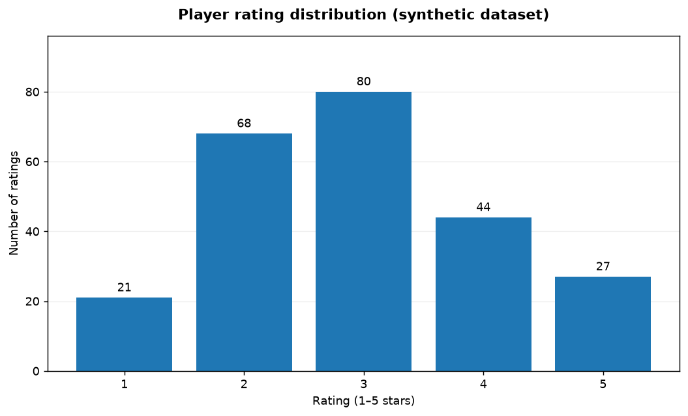
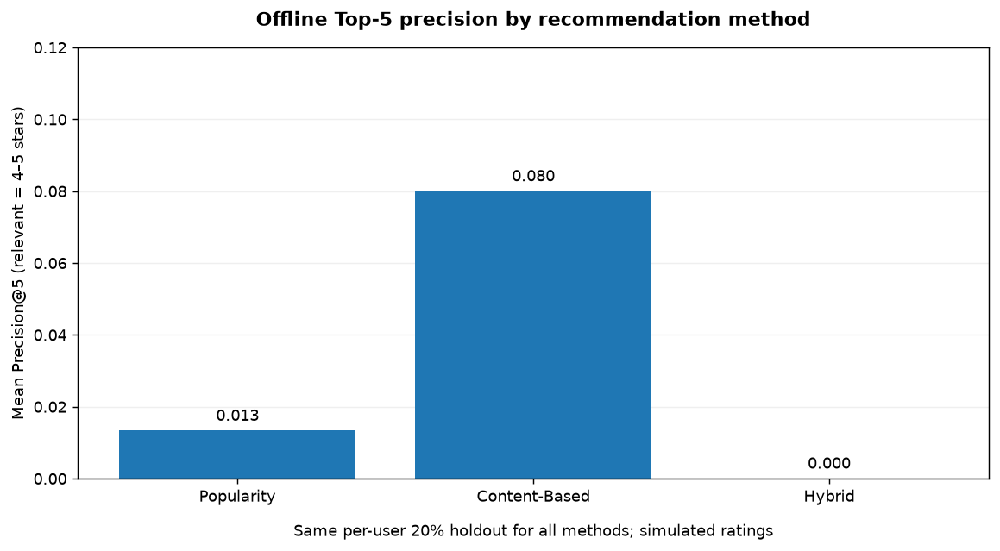

# CS467 Individual Mini-Project (MP-A12): Video Game Description and Tag Recommender

## Student & Course Information

| Field | Details |
| :--- | :--- |
| **Student Name** | Hoàng Ngọc So |
| **Student ID / Section** | 29211152581 \| CS467A (No. 12) |
| **Course** | CS467 Advanced Artificial Intelligence (2026–2027), Duy Tan University |
| **Instructor** | Puri Vikram |
| **Assigned Project Code** | MP-A12 |
| **Project Title** | Video Game Description and Tag Recommender |
| **Application Domain** | PC and Console Gaming Storefront |

---

## Problem Statement

PC and console game storefronts host thousands of titles spanning overlapping genres, themes, and gameplay mechanics. Players searching for a specific experience (such as *"story driven open world exploration with crafting"*) or browsing for their next unplayed title face information overload, while newly released or upcoming indie games suffer from cold-start visibility because they lack player ratings.

This project builds a Python recommender system that combines **Natural Language Processing (NLP)** over store descriptions, genre tags, and player reviews with **Collaborative Filtering (CF)** and **Popularity** baselines to deliver explainable Top-5 game recommendations.

---

## Dataset Description

A synthetic, domain-realistic dataset was created for the PC and Console Gaming Storefront domain inside `data/`:

- **`data/items.csv`** — **40 games** with 6 columns:
  `item_id`, `title`, `platform`, `genre_tags`, `store_description`, `play_mode`
- **`data/ratings.csv`** — **240 player interactions** across **15 users** (`U01`–`U15`) with 4 columns:
  `user_id`, `item_id`, `rating` (1–5), `player_review`
- **Matrix Sparsity**: Each of the 15 players rated exactly 16 of the 40 games, producing a user–item matrix with **60.00% missing entries** (within the 40%–65% target range).

---

## NLP and Recommendation Methods

### 1. NLP Pipeline (`src/nlp_pipeline.py`)
- **Text Preprocessing**: Lowercasing, underscore/punctuation removal, whitespace normalization (`clean_text`), tokenization, and English stop-word removal (`tokenize`).
- **TF-IDF Vectorization**: Unigram and bigram TF-IDF (`ngram_range=(1, 2)`, L2-normalized, sublinear TF) fitted on concatenated `genre_tags` and `store_description`.
- **Query Vectorization**: `transform_query` projects new free-text queries or unseen cold-start descriptions onto the **same fitted vocabulary** without refitting.
- **Keyword Attribution**: `matching_keywords` extracts the top overlapping TF-IDF terms contributing to cosine similarity.
- **Review Sentiment**: `review_sentiment` computes lexicon-based positive/negative ratios and a net `sentiment_score` in `[-1, +1]` with immediate negation handling (e.g., `"not good"`).

### 2. Recommendation Engine (`src/recommender.py`)
1. **Popularity Baseline**: Bayesian-smoothed average rating (`prior_count=3.0`, `min_rating_count=3`), excluding games already rated by the target user.
2. **NLP Content-Based Recommender**: Cosine similarity over TF-IDF vectors supporting free-text queries, item-to-item similarity, and user preference profiles weighted by `(rating - 3.0)`.
3. **Hybrid Recommender (Project Extension)**: Weighted combination of Content Similarity (`0.50`), User-Based Collaborative Filtering (`0.35`, mean-centered cosine with `min_common_ratings=2` and shrinkage `3.0`), and Review Sentiment (`0.15`), normalized over available signals so cold-start items remain discoverable.

---

## Installation and Run Commands

```bash
# 1. Install dependencies
pip install -r requirements.txt

# 2. Run the interactive CLI demo (runs all 3 test cases by default)
python -m src.main

# 3. Query by custom gameplay description or user ID
python -m src.main --query "story driven open world exploration with crafting"
python -m src.main --user U01 --method hybrid --top-k 5

# 4. Run offline evaluation, generate charts, and save sample outputs
python -m src.evaluate
```

---

## Sample Outputs for All 3 Test Cases

Saved in [`results/sample_outputs.txt`](results/sample_outputs.txt):

### Case 1 — Gameplay Query (`"story driven open world exploration with crafting"`)
```text
  1. Subnautica [G004] score=0.2878; keywords=exploration crafting, crafting, exploration, open world, open
  2. No Man’s Sky [G005] score=0.2628; keywords=exploration crafting, exploration, crafting, open world, open
  3. Red Dead Redemption 2 [G007] score=0.2324; keywords=driven, story, open world, open, world
  4. Sea of Thieves [G039] score=0.1631; keywords=open, exploration, open world, world
  5. Forza Horizon 5 [G027] score=0.1613; keywords=open world, open, world
```

### Case 2 — Player Library Test (Top-5 unrated games for `U01`, 16 rated games, via Hybrid)
```text
  1. Baldur’s Gate 3 [G034] score=0.9000; keywords=none (CF/review-driven match); CF estimated rating=5.00/5; review sentiment=+0.33
  2. Portal 2 [G023] score=0.8298; keywords=none (CF/review-driven match); CF estimated rating=4.37/5; review sentiment=+0.60
  3. Disco Elysium [G035] score=0.7259; keywords=none (CF/review-driven match); CF estimated rating=4.15/5; review sentiment=+0.17
  4. Rocket League [G026] score=0.7103; keywords=none (CF/review-driven match); CF estimated rating=3.69/5; review sentiment=+0.60
  5. It Takes Two [G024] score=0.6894; keywords=none (CF/review-driven match); CF estimated rating=3.98/5; review sentiment=+0.12
  All five games excluded from U01's existing library: True
```

### Case 3 — Cold-Start Test (Upcoming indie game `Forestcraft Horizons [NEW001]`, metadata only)
```text
  1. Forestcraft Horizons (fictional indie game) [NEW001] score=0.5126; keywords=world exploration, story driven, driven open, exploration crafting, driven
  2. Subnautica [G004] score=0.1999; keywords=exploration crafting, crafting, exploration, open world, open
  3. No Man’s Sky [G005] score=0.1824; keywords=exploration crafting, exploration, crafting, open world, open
  4. Red Dead Redemption 2 [G007] score=0.1610; keywords=driven, story, open world, open, world
  5. Sea of Thieves [G039] score=0.1160; keywords=open, exploration, open world, world
  Cold-start game appears in top five: True
  Cold-start game has zero player ratings: True
  Cold-start game rank: 1
```

---

## Evaluation Results & Charts

Offline evaluation uses a deterministic per-user ~20% holdout (`seed=42`, **195** training ratings, **45** test ratings; relevant item = held-out rating >= 4/5).

| Method | Users Evaluated | Users w/ Relevant Test Items | Precision@5 | Recall@5 | Hit Rate@5 | Mean Returned |
| :--- | :---: | :---: | :---: | :---: | :---: | :---: |
| **Popularity** | 15 | 11 | 0.0133 | 0.0909 | 0.0667 | 5.0000 |
| **Content-Based** | 15 | 11 | **0.0800** | **0.4545** | **0.4000** | 4.4000 |
| **Hybrid** | 15 | 11 | 0.0000 | 0.0000 | 0.0000 | 5.0000 |

- **User-Based CF Rating Prediction Diagnostics**: Coverage = `44/45` (`97.8%`), **MAE = `0.9847`**, **RMSE = `1.3274`**.





---

## Reflection

- **What Worked Well**: The TF-IDF unigram+bigram NLP pipeline effectively matched free-text gameplay queries, generated interpretable keyword explanations, and surfaced the unrated cold-start indie game (`NEW001`) at rank #1. In offline evaluation, Content-Based filtering outperformed Popularity (`Precision@5 = 0.0800` vs `0.0133`, `Hit Rate@5 = 0.4000` vs `0.0667`).
- **Limitations**: With only 15 users and ~3 held-out ratings per user, collaborative filtering overlaps are small and noisy, causing the Hybrid score to underperform pure Content-Based on this tiny synthetic split. Additionally, the lexicon-based sentiment analyzer relies on a fixed word list rather than contextual embeddings.
